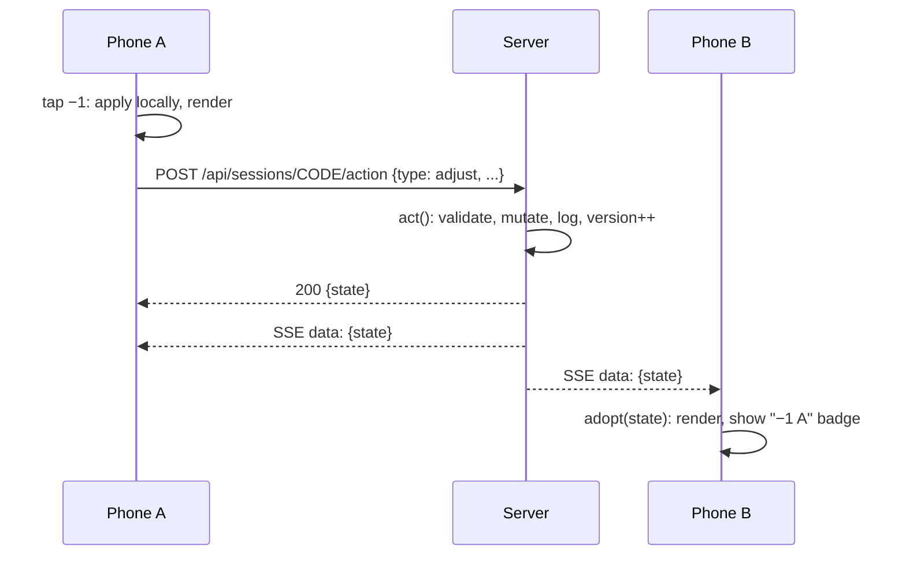

# Lifecount: architecture

Technical reference for the server, the client and the data they exchange. For an overview, running and deploying, see the [README](../README.md).

- [Stack](#stack)
- [Architecture](#architecture)
- [User flow](#user-flow)
- [Data flow](#data-flow)
- [Session state](#session-state)
- [Actions](#actions)
- [HTTP API](#http-api)
- [Persistence and lifecycle](#persistence-and-lifecycle)
- [Stats and attribution](#stats-and-attribution)
- [Client](#client)
- [Commander search](#commander-search)
- [Testing](#testing)

## Stack

| Part        | Choice                                                                         |
| ----------- | ------------------------------------------------------------------------------ |
| Server      | Node `http` module, ES modules, no dependencies (`server.js`, ~700 lines)      |
| Sync        | Server-Sent Events (one stream per phone) + JSON `POST` for actions            |
| Storage     | JSON file for live tables, JSON Lines file for finished games                  |
| Client      | One vanilla JS module, no framework and no build step (`public/app.js`)        |
| Styling     | Plain CSS with custom properties (`public/styles.css`)                         |
| Vendored    | `qrcode-generator`, Barlow and Barlow Condensed fonts (`public/vendor/`)       |
| External    | Scryfall API for commander search and card images (optional at runtime)        |
| Tests       | `node:assert` script that boots the server and plays games over HTTP           |

## Architecture

```
public/index.html        app shell, loads the QR library and app.js
public/app.js            client: routing, rendering, optimistic updates, SSE, Scryfall search
public/styles.css        design tokens and components
public/vendor/           QR generator and fonts (see LICENSES.md)
server.js                static files, JSON API, SSE, action reducer, idle sweep, stats
data/sessions.json       live tables (rewritten 500 ms after the last change)
data/games.jsonl         one finished or abandoned game per line
test/smoke.mjs           end-to-end test
render.yaml              Render blueprint
```

The server is authoritative. Phones never edit state directly: they send an action, the server applies it to the session (`act()` in `server.js`), increments `version`, and broadcasts the full public state to every phone at that table. Sending the whole state instead of diffs keeps the client simple; a table's state is a few kilobytes.

## User flow

1. **Home.** Create a table (name, optional commander, colour) or type a 4-letter code. The code uses letters without I and O.
2. **Join.** A phone that opens `#/s/CODE` and has no seat sees the seats already at the table and a new-seat form. Tapping a seat uses it on this phone (a seat someone added for you, or your own seat on another device). If that seat is already connected elsewhere, the phone asks first.
3. **Lobby.** Seat order is table order, clockwise; reorder with ↑/↓ or shuffle. Choose starting life (20 to 60) and whether to track turns. Anyone can **add a player without a phone**, and edit or remove seats that have no phone connected. Only the host can remove a connected player.
4. **Play.** With turn tracking on, choose who goes first or pick at random; it can be switched on or off from the menu during the game. Everyone sees the same state; anyone can change anyone's counters. When a phone-less player has the turn, every phone shows a **Pass** button in the top bar.
5. **End.** The game ends when one player is left, or from the menu with a chosen winner or a draw. The summary screen offers **Rematch** (same seats) or **Back to lobby**.
6. **Close.** The host can close the table. Otherwise it closes after `IDLE_MINUTES` without actions. A game still running at that point is saved as *abandoned*.

The game screen shows your life large at the bottom (tap left half −1, right half +1, hold to repeat) and opponents on top, laid out as seen from your seat: left neighbour bottom-left, right neighbour bottom-right, the rest across the top. Tapping a player opens a sheet with life ±1/5/10, poison, commander damage from each opponent, monarch, give the turn, eliminate/undo elimination, and their commander card. At 0 life, 10 poison or 21 commander damage the player is marked *Lethal*; elimination is always manual.

## Data flow



- **Optimistic updates.** `adjust()` on the client mirrors the server change locally so a tap shows instantly. While actions are in flight (`store.pending > 0`), incoming states are stashed, not rendered, so a slow echo can't undo a fast tap. When the last request returns, the newest state wins.
- **Coalescing.** Taps by the same phone on the same counter within 4 seconds merge into one log entry (`Luca −7`, not seven `−1`). Undo then reverts the whole burst.
- **Grouped changes.** Table actions (`bulk`) log every change with a shared `group` id, so one undo reverts all of them.
- **Delta badges.** When a new state arrives, the client compares each life total with the previous state and shows a badge with the change and who made it.
- **Clock skew.** Every state carries `serverNow`; the client uses the offset for turn and game clocks.
- **Keep-alive.** The server writes an SSE comment every 20 seconds. The client requests the table state every 5 minutes (see Deploy in the README) and when the tab becomes visible again.
- **Presence.** `online` in the state lists the player ids with an open stream. It drives the green dots, "On a phone" tags, the Pass-for-them button and who may remove a seat.

## Session state

`GET /api/sessions/CODE` and every SSE message return:

```js
{
  code: 'ABCD', status: 'lobby' | 'playing' | 'ended' | 'closed',
  hostId, version, lastActivity, serverNow, idleMinutes, closedReason,
  settings: { startingLife: 40, turns: true },
  online: [playerId, ...],
  players: [{
    id, name, color, seat, commander,
    card: { name, art, image, colors, uri, artist } | null,   // Scryfall pick
    life, poison, cmdr: { [sourcePlayerId]: damage }, monarch,
    eliminatedAt, place,
  }],
  game: {
    startedAt, endedAt, winnerId, activeId, turnNumber, turnStartedAt,
    turns: [{ n, playerId, start, end }],
    log: [{ kind: 'adjust' | 'start' | 'turn' | 'eliminate' | 'revive' | ..., t, by, target, field, delta, source, turn, group }],
  } | null,
}
```

`card` is only stored when its name matches `commander`, and image URLs must be on `cards.scryfall.io` (checked on the server and again in the client, since they end up in CSS `url()`).

## Actions

All go to `POST /api/sessions/CODE/action` as `{ playerId, type, ... }`. `playerId` must be a seat at that table.

| type           | when          | fields                                    | effect                                                        |
| -------------- | ------------- | ----------------------------------------- | ------------------------------------------------------------- |
| `settings`     | lobby         | `startingLife`, `turns`                   | starting life; turn tracking on/off                           |
| `profile`      | any           | `name`, `commander`, `card`, `color`, `target` | edit own seat, or seat `target`                          |
| `addPlayer`    | lobby         | `name`, `commander`, `card`, `color`      | add a seat with no phone                                      |
| `seats`        | lobby         | `order` (ids)                             | set table order                                               |
| `shuffleSeats` | lobby         |                                           | random order                                                  |
| `kick`         | lobby         | `target`                                  | remove a seat (host, or anyone if that seat is offline)       |
| `start`        | lobby, ended  | `firstId`                                 | reset counters, start a game                                  |
| `adjust`       | playing       | `target`, `field` (`life`/`poison`/`cmdr`), `delta`, `source` | one change; `cmdr` needs `source` and also changes life |
| `bulk`         | playing       | `label`, `ops` (list of adjusts)          | table action, undone as one                                   |
| `passTurn`     | playing       | `turn`                                    | next living player; ignored if `turn` is not the current turn |
| `setActive`    | playing       | `target`                                  | give the turn to a player                                     |
| `turnTracking` | lobby, playing| `on`, `firstId`                           | switch turn tracking during a game; `firstId` takes the turn  |
| `monarch`      | playing       | `target`                                  | toggle monarch (only one at a time)                           |
| `eliminate`    | playing       | `target`                                  | out, with finishing place; last one standing wins             |
| `revive`       | playing       | `target`                                  | undo an elimination                                           |
| `undo`         | playing       |                                           | revert this phone's last change or group                      |
| `end`          | playing       | `winnerId`                                | finish (no winner = draw)                                     |
| `backToLobby`  | ended         |                                           | back to the lobby, same seats                                 |
| `close`        | any           |                                           | host only; archive a running game as abandoned                |

## HTTP API

| method | path                              | returns                                          |
| ------ | --------------------------------- | ------------------------------------------------ |
| POST   | `/api/sessions`                   | create a table and the first seat: `{ code, playerId, state }` |
| GET    | `/api/sessions/:code`             | session state                                    |
| GET    | `/api/sessions/:code/stream?playerId=` | SSE stream of session states               |
| POST   | `/api/sessions/:code/join`        | new seat: `{ playerId, state }`                  |
| POST   | `/api/sessions/:code/action`      | apply an action: `{ state }`                     |
| GET    | `/api/stats`                      | aggregated stats                                 |
| GET    | `/api/games`                      | every archived game (download)                   |
| GET    | `/api/games/:id`                  | one archived game                                |
| GET    | `/api/info`                       | LAN URLs and idle timeout                        |

Errors are `{ error }` with status 400 (bad action) or 404 (unknown table). Any other path serves `public/`, falling back to `index.html`.

## Persistence and lifecycle

- Live tables live in memory and are written to `sessions.json` 500 ms after the last change. They are loaded on start, so a restart on a persistent disk keeps running games.
- A game is appended to `games.jsonl` when it ends (`finished`) or when its table closes mid-game (`abandoned`). The record holds players, seats, commanders and cards, final counters, places, all turns and the full log.
- An idle sweep runs every minute and closes tables with no actions for `IDLE_MINUTES`.
- Closing a table ends every SSE stream; phones show "Session closed".

## Stats and attribution

`computeStats()` reads `games.jsonl` and only counts `finished` games. Players are grouped by name, case-insensitive.

- Lowering another player's life from your phone counts as damage dealt by you. Commander damage counts for its source. Changes to your own life have no source.
- A KO goes to whoever last dealt attributed damage to the player before they were eliminated.
- Per player: games, wins, win rate, damage dealt, KOs, average and longest turn, favourite commander.
- Per commander: games, wins, win rate, art.
- Per game (`#/g/ID`): life-over-time chart, standings, damage dealt, KOs.

## Client

- **Routes** (hash based): `#/` home, `#/s/CODE` table (join, lobby, game, summary, closed), `#/stats`, `#/g/ID` past game, `#/help` guide. In-app navigation uses `history.pushState` with `{ inApp: true }`; Back uses browser history only when the previous entry is an app page, otherwise it goes to the parent page.
- **Rendering.** `render()` rebuilds `#app` from `store` with template strings. Before replacing the HTML it saves the values of any form being filled in and restores them afterwards, so a server update doesn't wipe what someone is typing. Bottom sheets (`#sheet-root`) render the same way and are skipped while an input in them has focus.
- **Events.** One delegated `click` listener dispatches `data-act` to `actions`; `submit` dispatches `data-form` to `forms`. Elements with `data-hold` repeat on press with acceleration.
- **Local storage.** `lc.profile` (name, commander, card, colour for the next table), `lc.player.CODE` (this phone's seat at that table), `lc.last` (table to resume).
- **Device.** Wake Lock during a game where supported, short vibration on taps (Android).

## Commander search

The commander field queries Scryfall directly from the browser:

```
GET https://api.scryfall.com/cards/search?order=edhrec&q=is:commander legal:commander name:"<word>" ...
```

`is:commander legal:commander` limits results to cards that can be a commander and are not banned. Results come sorted by EDHREC popularity; names whose words start with the typed text move to the top, and the first 8 are shown. Requests are debounced (220 ms) and the previous one is cancelled. Picking a result stores `{ name, art, image, colors, uri, artist }`. A typed name without a pick is saved as plain text. Without internet the field works as a text box.

## Testing

- `test/game.test.mjs` (`node --test`) imports `server.js` without starting the HTTP server and calls `act()`, `join()` and `cleanCard()` directly on in-memory sessions. Finished games are archived to a temporary `DATA_DIR`.
- `test/smoke.mjs` spawns the server on port 3999 with a temporary data directory and plays games over HTTP: seating, adjustments, coalescing, commander damage, poison, turns, monarch, table action and undo, eliminations, automatic end and places; a second client checks SSE; stats, rematch, closing mid-game; phone-less players, duplicate names, duplicate pass protection, removal by a non-host; turn tracking off and switched mid-game.
- `.github/workflows/test.yml` runs `npm test` on Node 20 and 22 for every push and pull request.
